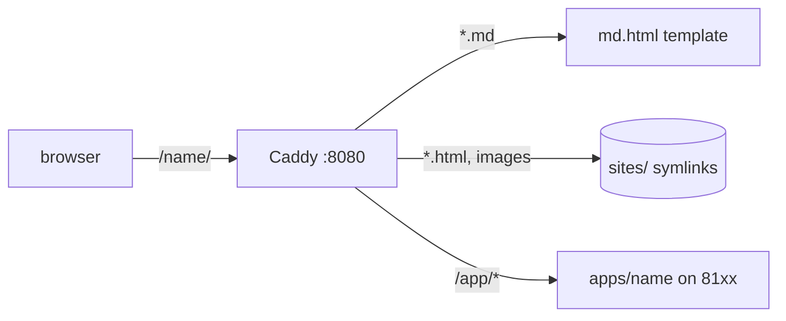

# Features

Relative links work: [back to the index](./), [a note](notes/first.md).

## Code

Highlighted on the server; every block gets a copy button.

```python
from pathlib import Path

def titles(root: Path) -> list[str]:
    """Collect the first heading of every README."""
    return [p.read_text().splitlines()[0] for p in root.glob("*/README.md")]
```

```bash
bin/lantern add-site deploy-notes ~/Projects/some-repo/docs
```

Template syntax inside docs is shown verbatim, not executed:

```yaml
image: "{{ .Values.image.repository }}:{{ .Values.image.tag }}"
```

Inline `code`, <kbd>Ctrl</kbd>+<kbd>C</kbd>, ~~strikethrough~~ and <mark>highlight</mark>.

## Table

| Command    | What it does                    |
|------------|---------------------------------|
| `add-site` | symlink a docs folder           |
| `add-app`  | scaffold an app with a free port |
| `doctor`   | check links, ports and Caddy    |

## Task list

- [x] Static docs
- [x] Markdown rendering
- [ ] World domination

## Raw HTML

<details>
<summary>Raw HTML in Markdown passes through</summary>

Useful for small embeds: <span style="color: var(--accent)">styled text</span>, iframes, video.

</details>

## Image


## Footnote

Footnotes are supported.[^1]

[^1]: Like this one.

## Diagram


